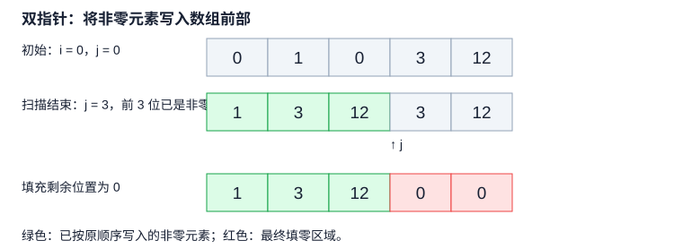

# LeetCode 283. 移动零

## 一、问题描述

**题目链接：** [LeetCode 283. 移动零](https://leetcode.cn/problems/move-zeroes/)

给定一个整数数组 `nums`，将所有 `0` 移动到数组末尾，同时保持非零元素的相对顺序。

要求**原地修改数组**，不能复制数组。

**示例：**

```text
输入：nums = [0, 1, 0, 3, 12]
输出：nums = [1, 3, 12, 0, 0]
```

**复杂度要求：** 尽可能减少操作次数，并使用 $`O(1)`$ 额外空间。

## 二、基本思路

采用**双指针**，将非零元素依次移动到数组前部，最后将剩余位置填充为 `0`。

**指针含义：** `i` 指向当前待检查的元素，`j` 指向下一个非零元素的填充位置；`j` 之前是所有已找到的非零元素，且保持原有顺序。

遍历数组，当 `nums[i] != 0` 时，将其写入 `nums[j]`，并令 `j += 1`；否则跳过。遍历结束后，将 `nums[j:]` 填充为 `0`。

### 过程示例

以 `nums = [0, 1, 0, 3, 12]` 为例：



遍历过程中，`nums[0:j]` 始终保存已扫描的全部非零元素；`nums[j:i]` 的内容无需关心，最终统一填零即可。

## 三、算法实现

```python
class Solution:
    def moveZeroes(self, nums: list[int]) -> None:
        j = 0

        for i in range(len(nums)):
            if nums[i] != 0:
                nums[j] = nums[i]
                j += 1

        for i in range(j, len(nums)):
            nums[i] = 0
```

**复杂度分析：**

- **时间复杂度：** $`O(n)`$，两次遍历数组，每个元素最多处理常数次。
- **空间复杂度：** $`O(1)`$，只使用常数个辅助变量。

## 四、正确性证明

**循环不变量：** 每次循环开始时，`nums[0:j]` 恰好包含已遍历的所有非零元素，且保持原有相对顺序；同时满足 $`0 \le j \le i`$。

1. **初始化**：`i = j = 0`，已遍历部分为空，不变量成立。
2. **保持**：若 `nums[i] != 0`，则将其写入 `nums[j]`，并令 `j += 1`；否则跳过。由于 $`j \le i`$，写入不会覆盖尚未遍历的元素，因此不变量保持。
3. **终止**：遍历结束时，`nums[0:j]` 包含原数组的所有非零元素，且顺序不变。将 `nums[j:]` 填充为 `0`，得到正确结果。

**复杂度分析：** 两次遍历数组，时间复杂度为 $`O(n)`$；仅使用常数个辅助变量，空间复杂度为 $`O(1)`$。
