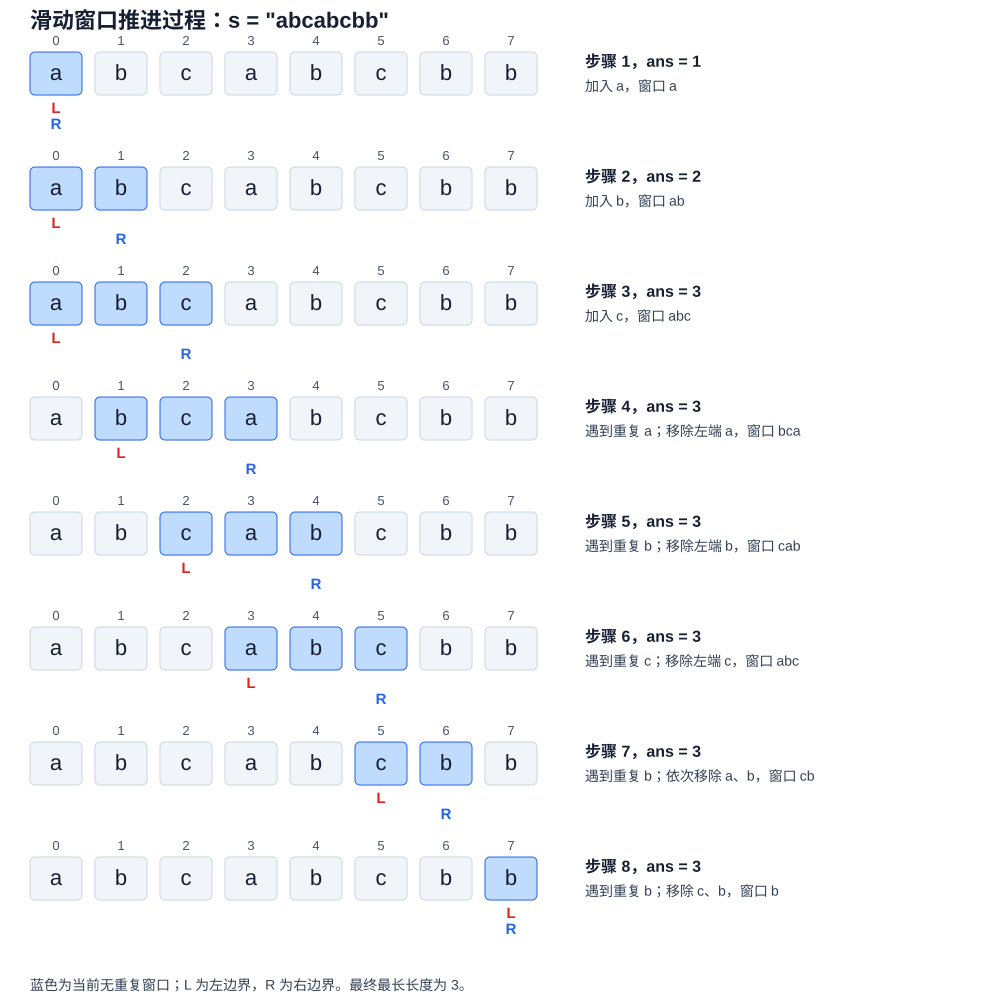

# LeetCode 3. 无重复字符的最长子串

## 一、问题描述

**题目链接：** [LeetCode 3. 无重复字符的最长子串](https://leetcode.cn/problems/longest-substring-without-repeating-characters/)

给定一个字符串 `s`，找出其中**不包含重复字符的最长子串**，返回该子串的长度。

**示例：**

```text
输入：s = "abcabcbb"
输出：3
解释：最长无重复字符子串为 "abc"，长度为 3。
```

其中，`"bca"`、`"cab"` 也是长度为 3 的无重复字符子串。

## 二、基本思路

本题体现了两种算法思想：**解空间分解**与**增量计算**。首先按照子串起点划分候选解空间，分别求出每个起点对应的最长无重复子串，再取最大值；随后利用相邻起点之间的关联，复用已有计算结果，避免重复搜索。

### 2.1 基本思路：解空间分解

设 $`f(i)`$ 表示以位置 $`i`$ 为起点的最长无重复字符子串的长度，则原问题可以表示为：

```math
ans=\max_{0\le i\lt n}f(i)
```

直接求解时，枚举每个起点 `i`，向右逐个检查字符，直到遇到重复字符，得到 $`f(i)`$。

这种方法需要反复扫描相邻起点对应的重叠区间，时间复杂度为 $`O(n^2)`$。

### 2.2 优化思路：增量计算（滑动窗口）

**核心思想：** 相邻起点对应的子串存在大量重叠，可以复用已检查过的字符，而不必每次重新扫描。

使用滑动窗口 `[left, right]` 维护一个**不包含重复字符**的连续区间，并使用 `set` 记录窗口内的字符。

- **扩展窗口**：右指针 `right` 向右移动，尝试加入新字符。
- **消除重复**：如果新字符已经存在，则不断移动左指针 `left`，移除窗口左侧字符，直到新字符不再重复。
- **更新答案**：加入新字符后，用窗口长度 `right - left + 1` 更新最大值。

**为什么可以复用已有结果？** 因为窗口内的字符已经确认互不重复。当右指针移动时，只需要检查新加入的字符；发生重复时，也只需要移除必要的前缀。

#### 示例：`s = "abcabcbb"`

下图逐步展示滑动窗口的扩展与收缩。蓝色表示当前有效窗口。



`left` 和 `right` 始终只向右移动。每个字符最多进入窗口一次、移出窗口一次，因此虽然存在内层 `while` 循环，总时间复杂度仍为 $`O(n)`$，辅助空间复杂度为 $`O(\min(n,|\Sigma|))`$。

这一优化的本质是：**利用相邻子问题之间的关联，通过维护已有结果实现增量计算，避免重复遍历。**

## 三、算法实现

```python
class Solution:
    def lengthOfLongestSubstring(self, s: str) -> int:
        left = 0
        seen = set()
        ans = 0

        for right, char in enumerate(s):
            while char in seen:
                seen.remove(s[left])
                left += 1

            seen.add(char)
            ans = max(ans, right - left + 1)

        return ans
```

**复杂度分析：**

- **时间复杂度：** $`O(n)`$。左右指针均只向右移动，每个字符最多被加入和移出集合各一次，`set` 的成员查询、插入和删除平均为 $`O(1)`$。
- **空间复杂度：** $`O(\min(n,|\Sigma|))`$。`set` 最多存储窗口内的所有字符，其中 $`|\Sigma|`$ 表示字符集大小。

## 四、正确性证明

### 4.1 循环不变量

每次外层循环结束时：

1. 窗口 `[left, right]` 内不存在重复字符。
2. 窗口是所有以 `right` 为右端点的无重复字符子串中最长的。
3. `ans` 等于截至当前位置，所有已处理子串的最大长度。

### 4.2 初始化

初始时，`left = 0`，`seen` 为空，`ans = 0`，尚未处理任何字符，循环不变量成立。

### 4.3 保持

假设处理位置 `right - 1` 后，循环不变量成立。现在加入字符 `s[right]`。

**情况一：新字符不重复**

直接将新字符加入窗口。由于原窗口不存在重复字符，扩展后的窗口仍然合法。

同时，原窗口的左边界已经是满足无重复条件的最小左边界，因此扩展后的窗口仍是以 `right` 为右端点的最长合法子串。

**情况二：新字符重复**

不断移动 `left`，移除窗口左侧字符，直到 `s[right]` 不再重复。

此时窗口恢复无重复状态，而且 `left` 是能够保持窗口合法的最小左边界：如果再向左扩展，就会重新包含重复字符。

因此，窗口仍是以 `right` 为右端点的最长无重复字符子串。

两种情况下，更新：

```python
ans = max(ans, right - left + 1)
```

即可得到截至当前位置的最大长度，循环不变量保持。

### 4.4 终止

外层循环遍历字符串的每个右端点，因此所有可能的最优子串右端点均已被考虑。

根据循环不变量，每次得到的窗口都是对应右端点的最长无重复字符子串，而 `ans` 保存了这些长度的最大值。

因此，算法返回的 `ans` 就是整个字符串中最长无重复字符子串的长度，算法正确。
