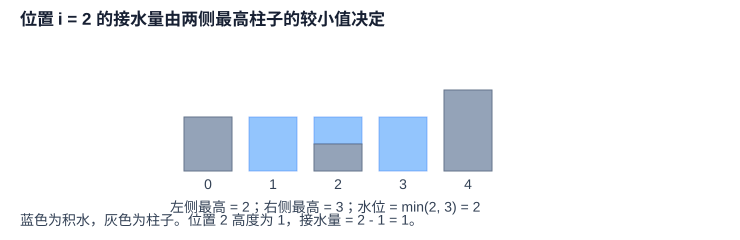
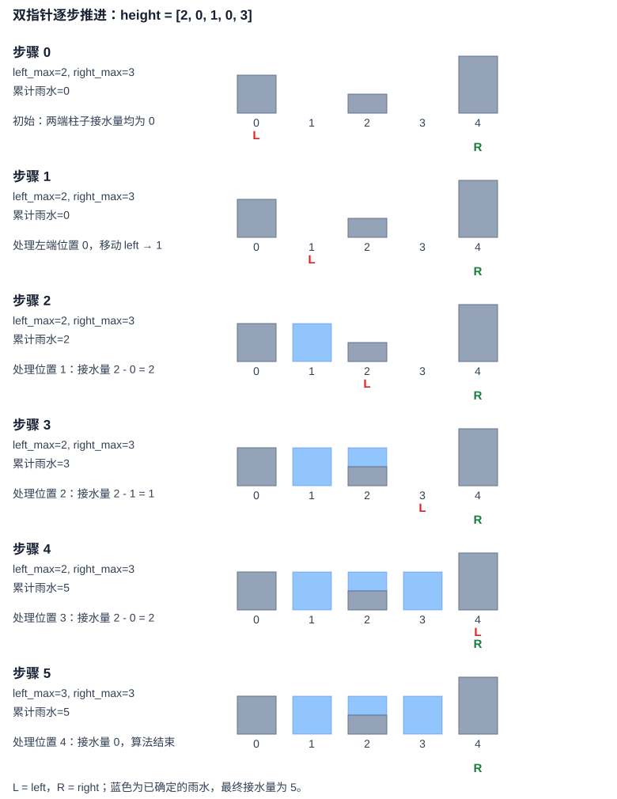

# LeetCode 42. 接雨水

## 一、问题描述

**题目链接：** [LeetCode 42. 接雨水](https://leetcode.cn/problems/trapping-rain-water/)

给定一个非负整数数组 `height`，其中每个元素表示宽度为 1 的柱子高度，计算下雨之后能够接住的雨水总量。

**示例：**

```text
输入：height = [2, 0, 1, 0, 3]
输出：5
解释：三个凹陷位置分别接住 2、1、2 单位雨水。
```

## 二、基本思路

本题采用**双指针**，核心是从雨水的形成条件出发，寻找能够确定接水量的位置，再逐步向中间推进。

### 2.1 雨水量的决定条件

对于位置 `i`，其接水量由左侧最高柱子和右侧最高柱子中**较低的一方**决定：

```math
water_{i}=\max(0,\min(L_{i},R_{i})-height_{i})
```

其中，$ `L_{i}` $ 和 $ `R_{i}` $ 分别表示位置 `i` 左右两侧（包含当前位置）的最高高度。



### 2.2 从能够确定的位置开始

**算法思维：从确定性出发，逐步扩展已解决区域。**

不必一开始就知道所有位置的答案，而是先找到能够确定结果的位置，再利用已知信息逐步缩小未知范围。

对于本题：

1. **寻找确定的初始状态**：数组两端的柱子接水量必然为 `0`，因此可以先确定这两个位置。
2. **逐步扩展已解决区域**：设置左右指针 `left`、`right`，从数组两端向中间推进。
3. **维护必要信息**：记录左右两侧已经遇到的最大高度 `left_max`、`right_max`，为下一步确定接水量提供依据。

### 2.3 如何移动指针

根据 2.1 的性质，每个位置的接水量由左右最高高度中较低的一方决定。

因此，每次比较 `left_max` 和 `right_max`：

- 如果 `left_max <= right_max`，处理左侧位置，并将 `left` 向右移动。
- 否则，处理右侧位置，并将 `right` 向左移动。

**关键：** 比较的是左右两侧已经遇到的最大高度，而不是仅比较两个指针当前位置的柱子高度。

以 `height = [2, 0, 1, 0, 3]` 为例，下图逐步展示指针推进和累计雨水量的变化：



图中蓝色部分表示已经确定的雨水。随着指针向中间推进，已解决区域逐渐扩大，最终得到总接水量 `5`。

## 三、算法实现

```python
class Solution:
    def trap(self, height: list[int]) -> int:
        left, right = 0, len(height) - 1
        left_max, right_max = 0, 0
        water = 0

        while left <= right:
            left_max = max(left_max, height[left])
            right_max = max(right_max, height[right])

            if left_max <= right_max:
                water += left_max - height[left]
                left += 1
            else:
                water += right_max - height[right]
                right -= 1

        return water
```

**复杂度分析：**

- **时间复杂度：** $`O(n)`$，左右指针每次向中间移动一步，每个位置恰好处理一次。
- **空间复杂度：** $`O(1)`$，仅使用常数个辅助变量。

## 四、正确性证明

采用**循环不变量**证明，重点说明为什么每次可以安全地处理较低的一侧。

### 4.1 循环不变量

每次循环开始时：

1. `left` 左侧和 `right` 右侧的位置均已正确计算接水量。
2. `left_max` 和 `right_max` 分别记录两侧已遍历区域的最大高度。
3. `water` 等于所有已处理位置的接水量之和。

### 4.2 初始化

初始时，尚未处理任何位置，`water = 0`，循环不变量成立。

### 4.3 保持

每次循环首先更新 `left_max` 和 `right_max`，然后根据两者大小决定处理哪一侧。

**情况一：`left_max <= right_max`**

右侧已存在高度不小于 `left_max` 的柱子，因此当前位置 `left` 的右侧最高高度至少为 `right_max`，不小于 `left_max`。

同时，`left_max` 是当前位置左侧（包含当前位置）的最高高度，因此当前位置的接水量必然为：

```math
water_{left}=left\_max-height[left]
```

该值已经确定，与尚未遍历的柱子无关。因此可以正确计算当前位置的接水量，并将 `left` 向右移动。

**情况二：`left_max > right_max`**

同理，左侧已存在高度不小于 `right_max` 的柱子，当前位置 `right` 的接水量必然为：

```math
water_{right}=right\_max-height[right]
```

因此可以正确计算当前位置的接水量，并将 `right` 向左移动。

两种情况下，每次处理的位置均正确，且不会重复处理；更新后的 `water` 仍然等于所有已处理位置的接水量之和，因此循环不变量保持。

### 4.4 终止

每次循环都会使 `left` 增加或 `right` 减少，因此循环最终在 `left > right` 时终止。

此时所有位置均已处理。根据循环不变量，`water` 等于所有位置的接水量之和，因此算法正确。
