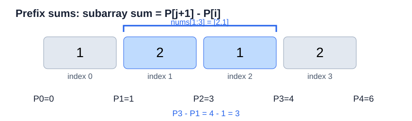

# LeetCode 560. 和为 K 的子数组

## 一、问题描述

**题目链接：** [LeetCode 560. 和为 K 的子数组](https://leetcode.cn/problems/subarray-sum-equals-k/)

给定一个整数数组 `nums` 和一个整数 `k`，统计数组中**元素之和等于 `k` 的连续非空子数组**的数量。

**示例：**

```text
输入：nums = [1, 2, 1, 2], k = 3
输出：3

解释：满足条件的子数组分别为：
      nums[0:2] = [1, 2]
      nums[1:3] = [2, 1]
      nums[2:4] = [1, 2]
```

## 二、基本思路

本题利用**解空间分解**，将原问题转化为统计每个起点或终点对应的合法子数组数量。首先通过按起点枚举得到朴素解法，再改为按终点枚举，利用前缀和与哈希表加速统计。

### 2.1 解空间分解：按起点枚举

将原问题分解为以每个位置为起点的子问题：对于每个起点 `i`，统计从该位置开始、元素之和等于 `k` 的连续子数组数量。

例如，`nums = [1, 2, 1, 2]`，`k = 3`：

```text
起点 0：[1] → [1,2] → [1,2,1] → [1,2,1,2]
起点 1：      [2] → [2,1] → [2,1,2]
起点 2：            [1] → [1,2]
起点 3：                  [2]
```

设 $`f(i)`$ 表示以位置 `i` 为起点、元素之和等于 `k` 的子数组数量，则：

```math
ans=\sum_{i=0}^{n-1}f(i)
```

枚举每个起点 `i`，向右逐步扩展子数组，同时维护当前元素之和。每当和等于 `k` 时，答案加一。

由于每个起点最多需要扫描 $`O(n)`$ 个元素，因此时间复杂度为 $`O(n^2)`$，辅助空间复杂度为 $`O(1)`$。

### 2.2 解空间分解：按终点枚举

除了按起点分解问题，也可以**按终点分解**：对于每个终点 `j`，统计以该位置结尾、元素之和等于 `k` 的连续子数组数量。

设 $`g(j)`$ 表示以位置 `j` 为终点、元素之和等于 `k` 的子数组数量，则：

```math
ans=\sum_{j=0}^{n-1}g(j)
```

**利用前缀和优化子问题求解。**

定义 $`P_j`$ 为前 `j` 个元素之和，其中 $`P_0=0`$。以位置 `j` 为终点、位置 `i` 为起点的子数组之和为：

```math
P_{j+1}-P_i
```



因此，子数组之和等于 `k`，等价于：

```math
P_i=P_{j+1}-k
```

这意味着：**对于每个终点 `j`，只需要统计此前有多少个前缀和等于 $`P_{j+1}-k`$。**

使用哈希表 `count` 记录已经出现的前缀和及其出现次数。从左向右遍历数组，每次执行：

1. **计算前缀和**：将当前元素加入 `prefix`。
2. **统计合法起点**：将 `count[prefix - k]` 累加到答案。
3. **记录当前前缀和**：将 `count[prefix]` 加一，供后续位置使用。

初始化 `count[0] = 1`，表示空前缀，使从数组位置 `0` 开始的子数组也能被正确统计。

#### 示例：`nums = [1, 2, 1, 2]`，`k = 3`


| 终点 `j` | 当前前缀和 | 查找 `prefix - k` | 新增子数组 | 累计答案 |
|---|---:|---:|---|---:|
| 0 | 1 | -2 | 无 | 0 |
| 1 | 3 | 0 | `[1, 2]` | 1 |
| 2 | 4 | 1 | `[2, 1]` | 2 |
| 3 | 6 | 3 | `[1, 2]` | 3 |

最终答案为 `3`。

**需要注意的地方：**

1. **记录出现次数，而不只是是否存在**：不同起点可能对应相同的前缀和，每个起点都代表一个不同的子数组。
2. **先查询，后更新**：当前前缀和只能作为后续子数组的起点，不能用于统计以当前位置结尾的空子数组。尤其当 `k = 0` 时，顺序错误会导致多计。
3. **按起点枚举能否优化？** 可以。按起点枚举时，可以从右向左扫描，利用前缀和与哈希表统计当前起点之后满足条件的终点，同样能达到平均 $`O(n)`$ 的时间复杂度。两种方式本质上都是统计前缀和之间满足特定差值关系的配对数量。**按终点枚举查询此前出现的前缀和，按起点枚举则查询此后出现的前缀和**；前者适合从左向右扫描并增量维护历史信息。

每个元素只遍历一次，哈希表查询与更新的平均时间为 $`O(1)`$，因此总时间复杂度为 $`O(n)`$，空间复杂度为 $`O(n)`$。

## 三、算法实现

```python
class Solution:
    def subarraySum(self, nums: list[int], k: int) -> int:
        count = {0: 1}
        prefix = 0
        ans = 0

        for num in nums:
            prefix += num
            ans += count.get(prefix - k, 0)
            count[prefix] = count.get(prefix, 0) + 1

        return ans
```

**复杂度分析：**

- **时间复杂度：** $`O(n)`$（平均）。每个元素只遍历一次，哈希表查询和更新的平均时间复杂度均为 $`O(1)`$。
- **空间复杂度：** $`O(n)`$。哈希表最多记录 $`n+1`$ 个不同的前缀和。

## 四、正确性证明

### 4.1 循环不变量

每次循环开始时，假设已经处理前 `j` 个元素：

1. `prefix` 等于前 `j` 个元素之和，即 $`P_j`$。
2. `count` 准确记录前缀和 $`P_0,P_1,\ldots,P_j`$ 的出现次数。
3. `ans` 等于所有终点位于前 `j` 个元素中的、元素之和等于 `k` 的非空子数组数量。

### 4.2 初始化

初始时，`prefix = 0`，`count = {0: 1}`，`ans = 0`。

此时尚未处理任何元素，哈希表只记录空前缀 $`P_0=0`$，不存在非空子数组，因此循环不变量成立。

### 4.3 保持

假设处理前 `j` 个元素后，循环不变量成立。现在处理 `nums[j]`。

首先更新前缀和：

```python
prefix += nums[j]
```

此时 `prefix` 等于 $`P_{j+1}`$。

对于任意起点 `i`，其中 $`0\le i\le j`$，子数组 `nums[i:j+1]` 的元素之和为：

```math
P_{j+1}-P_i
```

因此，该子数组的元素之和等于 `k`，当且仅当：

```math
P_i=P_{j+1}-k
```

根据循环不变量，`count` 已经准确记录所有历史前缀和 $`P_0,\ldots,P_j`$ 的出现次数。因此：

```python
ans += count.get(prefix - k, 0)
```

恰好统计了所有**以位置 `j` 为终点**的合法子数组，不会遗漏或重复。

随后执行：

```python
count[prefix] = count.get(prefix, 0) + 1
```

将 $`P_{j+1}`$ 加入哈希表，为后续计算提供历史信息。

因此，处理完当前位置后，三个循环不变量仍然成立。

### 4.4 终止

循环遍历数组中的全部 `n` 个元素后，所有可能的子数组终点均已处理。

根据循环不变量，`ans` 等于所有元素之和为 `k` 的非空连续子数组数量，因此算法正确。
