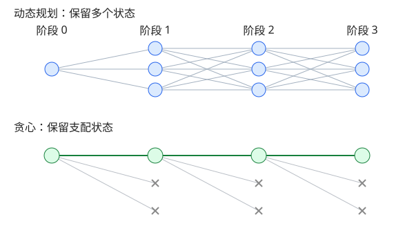
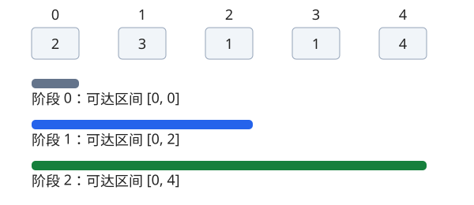

# 基于支配关系的贪心算法设计框架

## 1. 基本思想

贪心算法是一种通过逐步作出局部最优选择，构造全局最优解的算法设计方法。其关键在于：局部最优选择不会妨碍全局最优解的获得。

对于一类可以分阶段求解的优化问题：

1. 将全局优化问题划分为多个求解阶段。
2. 定义每个阶段的状态及其最优标准。
3. 建立状态之间的支配关系。
4. 仅保留当前阶段的最优状态，并推导下一阶段的最优状态。

如果状态 A 在相同求解条件下的后续求解中始终不劣于状态 B，则称 A 支配 B，可以安全地舍弃 B。

**核心思想：利用支配关系压缩每个阶段的状态空间，通过阶段最优状态的逐步扩展，构造全局最优解。**

## 2. 贪心算法与动态规划的关系

### 2.1 共同思想：分阶段求解

两者均可将全局优化问题分解为多个阶段的子问题，通过状态转移逐步求解。设 S 为阶段状态集合，T 为后继状态集合函数，则完整的候选状态转移为：

```math
S_{k+1}=\bigcup_{s\in S_{k}}T(s)
```

动态规划通常还会合并等价状态并保留相应的最优值。

### 2.2 核心区别：状态的保留与舍弃

动态规划通常需要保留多个必要状态，因为当前表现较好的状态，在后续求解中不一定仍然具有优势。

这一类贪心算法则能够找到一个支配当前阶段其他所有状态的最优状态，因此只需要保留该状态。



### 2.3 从动态规划到贪心算法

若第 k 阶段存在一个状态，能够支配该阶段的所有其他状态：

```math
s_{k}^{*}\succeq s,\quad s\in S_{k}
```

并且每个被支配状态的后继都能被保留状态的某个后继支配，那么只需要基于当前最优状态求解下一阶段：

```math
s_{k+1}^{*}=\operatorname{best}(T(s_{k}^{*}))
```

从而将多状态转移简化为：

```math
s_{0}^{*}\rightarrow s_{1}^{*}\rightarrow s_{2}^{*}\rightarrow\cdots
```

**从这一角度来看，这一类贪心算法可以理解为动态规划的一种特殊优化：利用支配关系消除冗余状态。**

## 3. 实例分析：跳跃游戏 II

### 3.1 转换问题视角

原始问题是求从起点到达终点所需的最少跳跃次数。

转换视角：给定跳跃次数，求能够到达的最远位置，并逐步增加跳跃次数，直到能够到达终点。

### 3.2 划分求解阶段与定义状态

以跳跃次数 k 划分阶段，以不超过 k 次跳跃能够到达的位置集合表示阶段状态。

由于每次可以选择任意不超过最大跳跃长度的步数，可达位置集合始终构成连续的整数区间：

```math
S_{k}=[0,R_{k}]
```

其中 R 为最远合法可达位置。因此，只需要一个整数表示整个阶段的可达状态。

### 3.3 建立状态间的支配关系

考虑相同跳跃预算下的两个候选累计可达区间 A=[0,a] 和 B=[0,b]。若 a 不小于 b，则：

```math
B\subseteq A
```

B 中所有能够用于后续跳跃的位置，在 A 中也都存在。因此 A 支配 B，且扩展可达范围的操作保持这种包含关系。

这里的支配关系建立在累计可达区间之间，而不是两个具体的落脚位置之间。候选区间是对可达信息的描述，不代表不同单条路径各自能到达整个区间。

### 3.4 逐步构造阶段最优状态

初始状态为：

```math
R_{0}=0
```

设数组长度为 n，则下一阶段的最远合法可达位置为：

```math
R_{k+1}=\min(n-1,\max_{0\le i\le R_{k}}(i+\mathrm{nums}[i]))
```

以 nums = [2,3,1,1,4] 为例：



| 阶段 | 最优状态的计算 | 最远位置 |
| --- | --- | --- |
| 0 | 初始状态 | 0 |
| 1 | 0+2 | 2 |
| 2 | max(2,4,3) | 4 |

由于可达区间不断扩大，已经枚举过的位置无须重复枚举。通过增量维护下一阶段的最大边界，可实现线性时间和常数额外空间。

### 3.5 从阶段最优到全局最优

每个阶段都维护不超过当前跳跃次数的完整可达范围。若第 k 阶段首次覆盖终点（起点即终点时答案为 0），则：

```math
R_{k-1}\lt n-1\le R_{k}
```

这说明跳跃 k-1 次及以内无法到达终点，而跳跃 k 次可以到达终点，因此 k 就是全局最优解。

## 4. 通用算法设计框架

### 4.1 问题转换与阶段划分

转换求解视角，将全局优化问题转化为多个逐步推进的阶段优化问题。例如，以跳跃次数作为阶段。

### 4.2 状态定义与局部最优标准

定义每个阶段的状态及其评价标准。例如，以可达区间作为状态，以右边界最大作为最优标准。

### 4.3 建立并证明支配关系

证明阶段最优状态能够支配其他候选状态，且支配关系在后续求解中能够保持，从而安全地舍弃其他状态。

### 4.4 最优状态的转移与扩展

仅保留当前阶段的最优状态，并基于该状态推导下一阶段的最优状态：

```math
s_{k+1}^{*}=\operatorname{best}(T(s_{k}^{*}))
```

### 4.5 全局最优解的构造与证明

定义终止条件，证明阶段最优状态的逐步扩展能够保证最终结果的全局最优性。

### 4.6 总结

**阶段划分 → 状态定义 → 支配关系 → 最优状态转移 → 全局最优解。**

## 5. 适用条件与局限性

### 5.1 适用条件

- 阶段性：全局问题能够分解为逐步推进的阶段优化问题。
- 状态支配性：每个阶段存在一个能够支配其他候选状态的最优状态。
- 支配保持性：支配关系在后续状态转移中能够保持。
- 全局最优性：能够通过阶段最优状态构造全局最优解。

### 5.2 不适用的情况

如果状态之间存在多个相互制约的评价指标，无法找到一个支配其他所有状态的最优状态，则不能直接使用这一框架。

例如，0-1 背包问题中，两个候选状态可能分别具有更小的重量和更高的价值，无法简单判断哪个状态在后续求解中更有优势，因此通常需要保留多个状态，使用动态规划等方法求解。

**判断能否采用这一类贪心算法的关键，不是能否定义局部最优标准，而是能否证明该标准下的最优状态能够安全地替代其他状态。**
